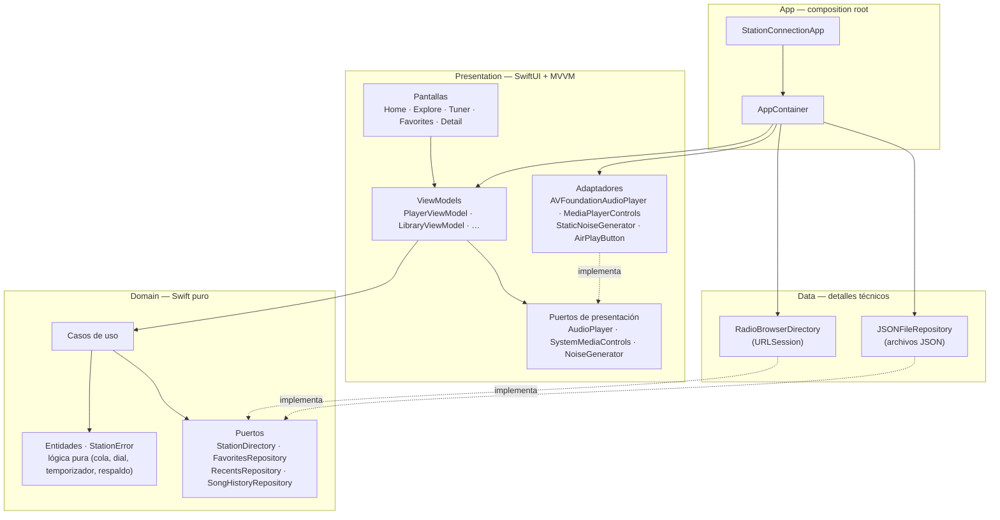
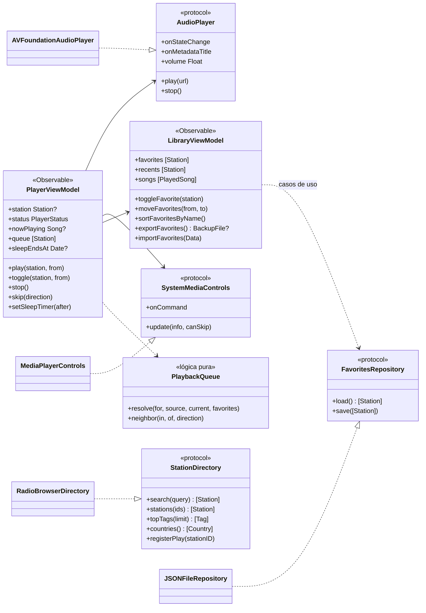
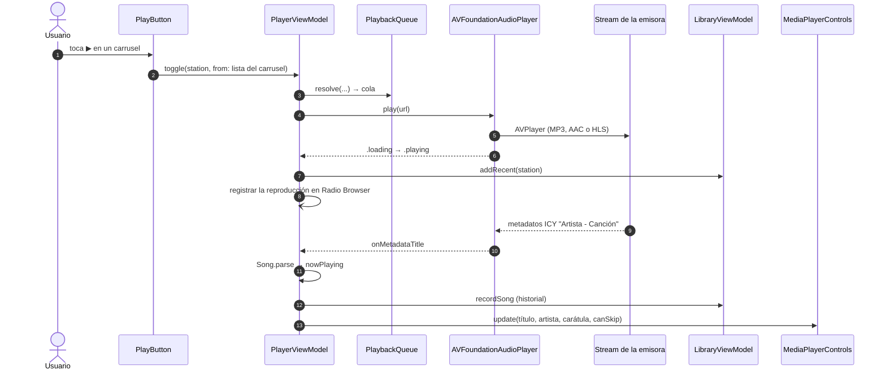
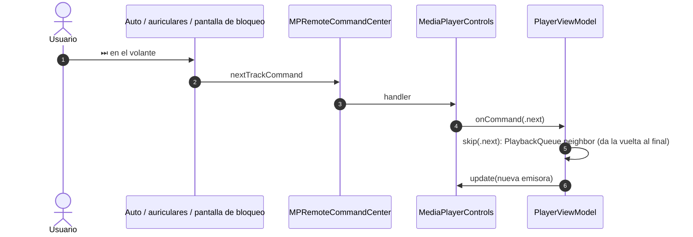
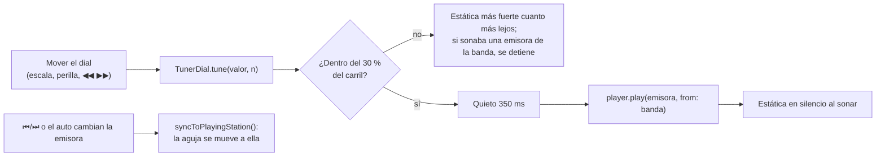
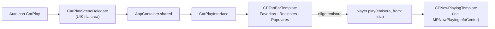

# Arquitectura

StationConnection-ios usa **Clean Architecture** con **MVVM**. El porqué está
en [ADR 0003](adr/0003-clean-architecture-mvvm.md); aquí se explica cómo está
montado.

## 1. La idea en una frase

El código se separa en capas y **las dependencias solo apuntan hacia dentro**:
la interfaz y los detalles técnicos (AVFoundation, red, archivos) dependen de
las reglas de la app, nunca al revés.



Las flechas continuas son "usa"; las punteadas, "implementa". **Ninguna flecha
sale de Domain.**

## 2. Capas

| Capa | Carpeta | Qué contiene | Puede importar |
| ---- | ------- | ------------ | -------------- |
| **Domain** | `StationConnection/Domain` | Entidades, errores, puertos, casos de uso y lógica pura. | Solo `Foundation`. |
| **Data** | `StationConnection/Data` | Cliente de Radio Browser y repositorios JSON. | `Foundation`, Domain. |
| **Presentation** | `StationConnection/Presentation` | Vistas SwiftUI, ViewModels y adaptadores de frameworks del sistema. | `SwiftUI`, `AVFoundation`, `AVKit`, `MediaPlayer`, `UIKit`, Domain. |
| **App** | `StationConnection/App` | Punto de entrada, creación de dependencias y piezas falsas para `-uiTesting`. | Todo. |

Reglas (también en `AGENTS.md`):

1. **Domain no importa** nada salvo `Foundation`.
2. **Presentation no conoce Data.** Los ViewModels reciben casos de uso.
3. **AVFoundation y MediaPlayer solo se tocan en sus adaptadores**
   (`AVFoundationAudioPlayer`, `MediaPlayerControls`, `StaticNoiseGenerator`,
   `AirPlayButton`). Los ViewModels usan los protocolos.
4. **Solo `AppContainer` crea implementaciones concretas.**
5. Data traduce sus errores técnicos a `StationError`.

## 3. Estructura de carpetas

```text
StationConnection/
├── App/
│   ├── StationConnectionApp.swift   Punto de entrada (@main)
│   ├── AppContainer.swift           Crea y conecta las dependencias (shared)
│   ├── CarPlaySceneDelegate.swift   Escena de CarPlay
│   └── UITestingSupport.swift       Directorio, audio y repos falsos (-uiTesting)
├── Domain/
│   ├── Entities/                    Station, Song, Tag, Country, StationQuery
│   ├── Errors/StationError.swift    Errores con mensaje para el usuario
│   ├── Repositories/                Puertos: StationDirectory y biblioteca
│   ├── Services/                    Lógica pura: PlaybackQueue, ListOperations,
│   │                                TunerDial, SleepTimer, MusicSearchLinks,
│   │                                FavoritesBackup
│   └── UseCases/                    DirectoryUseCases, LibraryUseCases
├── Data/
│   ├── Network/                     RadioBrowserDirectory, DTO y Mapper
│   └── Persistence/                 JSONFileRepository<Item>
├── Presentation/
│   ├── Common/                      Tema, LibraryViewModel, filas, tarjetas,
│   │                                carátulas, botones ▶ y ❤️, cola del entorno
│   ├── Player/                      PlayerViewModel, puertos y adaptadores de
│   │                                audio y controles, barra mini, "Reproduciendo",
│   │                                AirPlay, temporizador, enlaces de música
│   ├── Home/ · Explore/ · StationDetail/ · Favorites/
│   ├── Tuner/                       TunerViewModel, TunerScreen, estática
│   ├── CarPlay/CarPlayInterface.swift Plantillas de CarPlay (Favoritas, Recientes, Populares)
│   └── Root/RootView.swift          Pestañas + barra del reproductor
└── Resources/Assets.xcassets        Ícono, carátula para "Reproduciendo", colores

StationConnectionTests/
├── Doubles/                         Directorio, audio, controles y estática falsos
├── Domain/ · Data/ · Presentation/
StationConnectionUITests/            Toca la app real en el simulador
```

## 4. Tipos principales



`PlayerViewModel` y `LibraryViewModel` son **una sola instancia** para toda la
app, inyectada con `.environment(_:)`: la barra mini, "Reproduciendo", el Dial,
los corazones de cada fila y CarPlay ven el mismo estado.

## 5. Reproducir una emisora y "Sonando ahora"



## 6. Botones del auto, auriculares y pantalla de bloqueo



Si las favoritas suenan como cola y el usuario las reordena,
`LibraryViewModel.onFavoritesChanged` avisa al reproductor, que adopta el
nuevo orden al instante.

## 7. El Dial



## 8. Datos guardados

| Archivo (`Application Support/StationConnection/`) | Contenido |
| --- | --- |
| `favorites.json` | Favoritas en el orden del usuario (mismo formato de campos que la web) |
| `recents.json` | Últimas 12 emisoras escuchadas |
| `songs.json` | Últimas 50 canciones detectadas |

El respaldo exportado (`stationconnection-favoritas-AAAA-MM-DD.json`) tiene el
formato de la web: `{ app, version, exportedAt, favorites }`. Al importar,
cada emisora se **vuelve a sanear** (`FavoritesBackup.sanitize`): un archivo es
un dato no confiable.

## 9. CarPlay



Requiere el permiso `carplay-audio` (cuenta de pago); con Sideloadly la app no
aparece en el auto, pero "Reproduciendo" y ⏮/⏭ sí funcionan. Ver
[ADR 0009](adr/0009-carplay.md).

## 10. Pruebas

| Qué | Dónde | Cómo |
| --- | ----- | ---- |
| Lógica pura y casos de uso | `StationConnectionTests/Domain` | Sin dobles o con repositorios en memoria. |
| Radio Browser | `StationConnectionTests/Data` | `StubURLProtocol` responde sin red (espejos, 4xx, caché). |
| Repositorio JSON | `StationConnectionTests/Data` | Carpeta temporal. |
| ViewModels | `StationConnectionTests/Presentation` | `FakeAudioPlayer`, `FakeMediaControls`, `FakeNoiseGenerator`, reloj inyectado. |
| Interfaz | `StationConnectionUITests` | La app real con `-uiTesting` (sin red ni audio). |

Los adaptadores de AVFoundation y MediaPlayer no tienen pruebas automáticas:
se verifican a mano en el iPhone.
