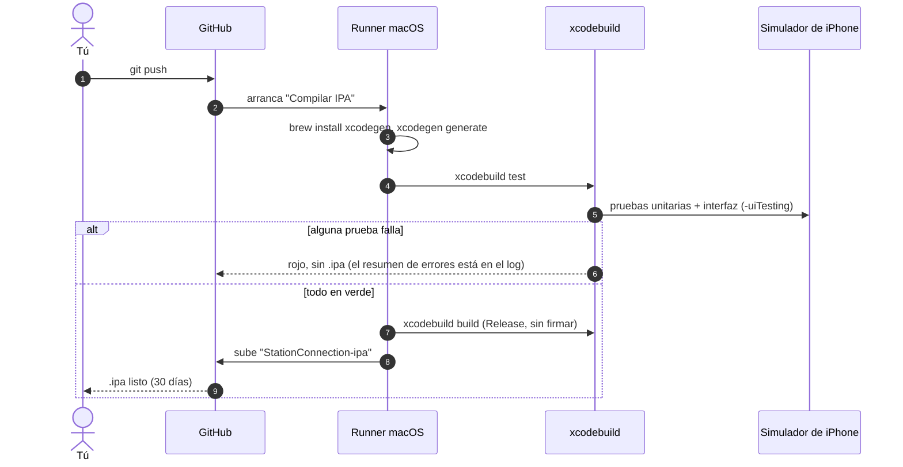

# Compilación e instalación (sin Mac, desde Windows)

Cómo pasa el código de este repo a ser una app en tu iPhone o iPad usando
solo GitHub y un PC con Windows. El porqué de cada pieza está en
[ADR 0004](adr/0004-compilar-sin-mac.md). Es el mismo proceso que
[DrawPad](https://github.com/jhonjairo6230/DrawPad).

## 1. Vista general

```mermaid
flowchart LR
    A["Código Swift<br/>+ project.yml"] -->|git push| B["GitHub Actions<br/>(Mac en la nube)"]
    B -->|XcodeGen| C["StationConnection.xcodeproj"]
    C -->|xcodebuild test| D["Pruebas en<br/>simulador de iPhone"]
    D -->|xcodebuild build| E["StationConnection.app<br/>sin firmar"]
    E -->|zip| F["StationConnection-unsigned.ipa<br/>(artefacto)"]
    F -->|descarga| G["PC con Windows<br/>Sideloadly"]
    G -->|firma con tu Apple ID<br/>e instala por USB| H["iPhone / iPad"]
```

## 2. Qué hace el workflow

Archivo: [`.github/workflows/build.yml`](../.github/workflows/build.yml).
Se ejecuta en cada `push` a las ramas de Git Flow, en cada pull request y a
mano (**Actions → Compilar IPA → Run workflow**).

| Paso | Por qué |
| ---- | ------- |
| `xcodegen generate` | El `.xcodeproj` no está en git; se crea desde `project.yml`. |
| `scripts/pick_simulator.py iPhone` | Los nombres de simuladores cambian con cada Xcode; el script elige un iPhone que exista. |
| `CODE_SIGNING_ALLOWED=NO` | En el runner no hay certificados de Apple. La firma la hace Sideloadly. |
| `Payload/` + `zip` | Un `.ipa` es un `.zip` con la app dentro de `Payload`. |

## 3. Preparar Windows y el iPhone (una sola vez)

1. Instala **iTunes** desde [apple.com/itunes](https://www.apple.com/itunes/)
   (la del sitio de Apple, no la de Microsoft Store).
2. Instala **Sideloadly** desde [sideloadly.io](https://sideloadly.io).
3. Conecta el iPhone por USB, desbloquéalo y toca **Confiar**.
4. En el iPhone: **Ajustes → Privacidad y seguridad → Modo de desarrollador →
   activar**. Se reinicia. Si no aparece, saldrá tras el primer intento.

## 4. Instalar la app

1. En GitHub: **Actions → Compilar IPA →** la ejecución más reciente en verde
   **→ Artifacts → StationConnection-ipa**.
2. Descomprime el `.zip`: dentro está `StationConnection-unsigned.ipa`.
3. Abre Sideloadly con el iPhone conectado y arrastra el `.ipa`.
4. Escribe tu **Apple ID** y pulsa **Start** (contraseña y código si tienes
   doble factor).
5. En el iPhone: **Ajustes → General → VPN y gestión de dispositivos →** tu
   Apple ID **→ Confiar**.
6. Abre StationConnection.

> Si prefieres no usar tu Apple ID principal, crea uno solo para esto.

## 5. Límites de la cuenta gratuita

| Límite | Qué significa |
| ------ | ------------- |
| Caduca a los **7 días** | Reinstala con Sideloadly. Tus favoritas se conservan si no desinstalas. |
| **3 apps** así a la vez | Por dispositivo (DrawPad y StationConnection cuentan). |
| **Sin permisos especiales** | iOS descarta el de **CarPlay** ([ADR 0009](adr/0009-carplay.md)). Con cuenta de pago (99 USD/año) y el permiso de Apple, la app aparecería en la pantalla del auto. |
| **Widgets** | La extensión usa un segundo identificador (`….widgets`); los Apple ID gratuitos tienen un cupo semanal de identificadores. Si la firma no incluye el App Group, el widget muestra "▶ retoma tu última emisora" en vez de la emisora, pero sus botones funcionan ([ADR 0010](adr/0010-widgets.md)). |

### Añadir los widgets

1. En la pantalla de inicio, mantén pulsado un espacio vacío → **Editar** → **Añadir widget**.
2. Busca **StationConnection** y elige "Sonando" (pequeño) o "Favoritas" (mediano).
3. En el auto (iOS 26+): **Ajustes → General → CarPlay → tu auto → Widgets** y activa "Sonando".

## 6. Problemas frecuentes

| Síntoma | Causa y solución |
| ------- | ---------------- |
| Sideloadly no ve el iPhone | Falta iTunes de apple.com o tocar **Confiar**. |
| La app no abre tras instalar | Activa el **Modo de desarrollador** y **Confía** en tu Apple ID. |
| "No se puede verificar la app" | Caducó la firma de 7 días: reinstala. |
| El workflow falla en "Pruebas" | El paso "Errores de compilación o pruebas" resume qué falló. |
| Una emisora no suena | Puede usar un formato que `AVPlayer` no soporta o estar caída: prueba otra. |
