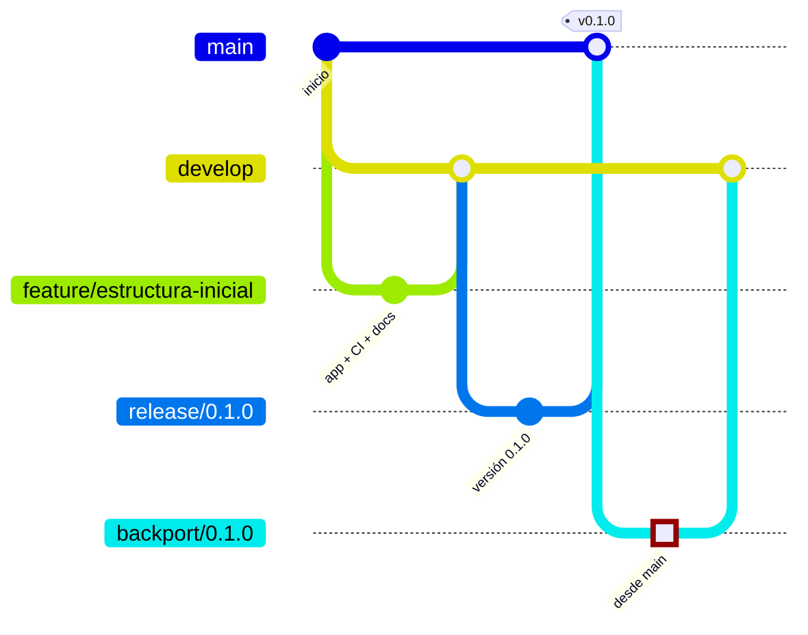

# Flujo de trabajo (Git Flow)

Decisión registrada en [ADR 0002](adr/0002-git-flow.md).

## Ramas

| Rama | Sale de | Se fusiona en | Para qué |
| ---- | ------- | ------------- | -------- |
| `main` | — | — | Versiones publicadas. |
| `develop` | `main` | — | Integración: lo próximo que saldrá. |
| `feature/<nombre>` | `develop` | `develop` | Funcionalidades, arreglos o documentación. |
| `release/<x.y.z>` | `develop` | `main` | Subir `MARKETING_VERSION` y arreglos de última hora. |
| `backport/<x.y.z>` | `main` (tras la release) | `develop` | Igualar `develop` con `main`. |
| `hotfix/<x.y.z>` | `main` | `main` | Arreglo urgente. Después, `backport/<x.y.z>`. |

Reglas:

- **Nunca** commits directos en `main` ni en `develop`, ni pull requests de
  `develop` a `main`.
- Solo esos prefijos, en minúsculas y con guiones. **No** ramas `claude/…`.
- Antes de fusionar, **Compilar IPA** tiene que estar en verde.
- **Fusiona el backport de una release antes de sacar la siguiente.**

## Versiones

Versionado semántico `x.y.z` en `project.yml` (`MARKETING_VERSION`):
funcionalidad nueva sube `y`, solo arreglos suben `z`. Solo se cambia en
ramas `release/` o `hotfix/`.

## Publicar una versión

1. `git switch develop && git pull && git switch -c release/0.2.0`
2. Sube `MARKETING_VERSION` en `project.yml`. Commit, push y pull request a `main`.
3. Tras fusionar: `git switch main && git pull && git switch -c backport/0.2.0`,
   push y pull request a `develop`.
